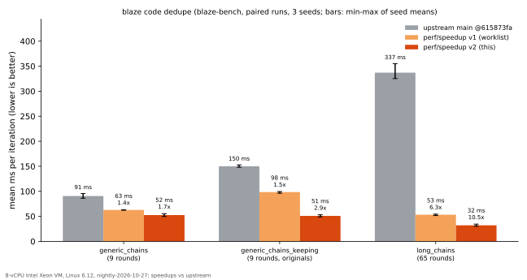

# PERF: `perf/speedup`

What this branch makes faster, by how much, how it was measured, and what it could not
measure. Everything here was run on the machine described below; nothing is projected.

## Results



Paired runs of blaze-bench's `dedupe` benchmarks (`crates/blaze-bench/benches/dedupe.rs`).
The numbers are means per iteration, in ms. The range in brackets is the spread of the three
per-seed means (seeds 1, 2 and 3), and the speedup is upstream's mean over this branch's.

| Scenario | upstream `main` @615873fa | v1 (worklist, a252634) | v2 (this) | v2 vs upstream | v2 vs v1 |
|---|---:|---:|---:|---:|---:|
| `generic_chains` (32,768 functions, 9 rounds) | 90.6 (86.2–95.6) | 62.8 (62.2–63.3) | 52.5 (49.8–55.3) | **1.7×** (−42%) | 1.26× (−20%) |
| `generic_chains_keeping` (the same, with `Originals`) | 150.1 (148.0–152.8) | 98.4 (96.1–99.6) | 50.9 (48.7–53.1) | **2.9×** (−65% to −67%) | 2.0× (−49% to −50%) |
| `long_chains` (32,768 functions, 65 rounds) | 337.1 (325.2–355.2) | 53.3 (51.6–54.4) | 32.0 (30.2–34.4) | **10.5×** (−90% to −91%) | 1.8× (−43% to −45%) |
| `floor/clone` (control) | 4.4–4.9 | 4.2–4.6 | 4.2–4.9 | 1.0× (−0.7% to +0.3%) | — |
| `floor/code_ids` (control) | 11.9–12.6 | 11.2–11.5 | 11.4–12.2 | ~1.0× (−4.4% to −2.1%) | — |

How the columns were measured:

- The upstream and v2 columns come from `compare` runs of v2 against upstream.
- The v1 column comes from `compare` runs of v2 against v1. The v2-against-v1 means for the
  three scenarios were 49.8–50.1, 47.8–50.9 and 29.0–30.5 ms.
- Every scenario difference is significant (|z| ≥ 2.6).

What the control rows show:

- The floors never call dedupe. `floor/code_ids` calls `content::code_id`, which v2 rewrote
  as a call to the generic `code_into` (the BLAKE3 output is unchanged and tested). It moved
  −4.4% to +5.2% across all runs.
- `floor/clone` moved −2.5% to +1.6%.
- So a difference under about 5% is noise on this machine.

Raw runner output is kept in two files:

- [docs/perf/dedupe-compare.txt](docs/perf/dedupe-compare.txt), the paired runs;
- [docs/perf/dedupe-solo.txt](docs/perf/dedupe-solo.txt), unpaired runs with min, mean, max
  and stddev.

The unpaired runs, in ms (min … mean … max):

| | upstream | v1 | v2 |
|---|---|---|---|
| `generic_chains` | 72.7 … 78.4 … 230.6 (σ 11.0) | 47.3 … 54.8 … 78.5 (σ 3.9) | 36.5 … 43.8 … 207.9 (σ 9.2) |
| `generic_chains_keeping` | 118.9 … 137.8 … 175.3 (σ 10.2) | 74.4 … 93.3 … 152.9 (σ 9.4) | 34.1 … 42.6 … 235.6 (σ 10.9) |
| `long_chains` | 315.6 … 327.2 … 393.9 (σ 13.5) | 40.3 … 46.8 … 65.6 (σ 3.6) | 20.9 … 25.0 … 128.2 (σ 5.3) |

**This is not a 20× (or 500×) faster blaze.** It is a 1.7× to 10.5× faster code-dedupe pass
(identical code folding), one stage of blaze's codegen. End-to-end rebuild times were not
measured (see Limits).

### Why the benchmarks stop short of 20×

- **`generic_chains`: 20× is out of reach by construction.**
  - 20× would be 4.5 ms per iteration. Each iteration first copies the 32,768-function build
    and then drops it. That alone is `floor/clone`, 4.2–4.9 ms, before any folding.
  - Instrumented, the fold itself now takes about 28 ms of v2's ~40 ms unpaired iteration.
    That ~28 ms is spent on:
    - writing every candidate's code bytes once (~6 ms);
    - ~16k renames and re-writes of the renamed functions' code (~8 ms);
    - grouping (~5 ms);
    - building the answer's `BTreeMap` of 20k merges (~4 ms);
    - taking out the merged functions and putting the rest in key order (~3 ms).
  - All of that is work the driver needs: the answer, the renamed functions and their order
    are its output.
- **`generic_chains_keeping` is bounded the same way.** It additionally keeps a copy of each
  renamed function.
- **`long_chains` is 10.5×.** 20× would be 16.9 ms. Its 65 rounds each rename a few hundred
  functions, a few milliseconds of renaming in all. On top of that comes the same one-off cost
  of writing the 32,768 codes, the merge map and the final order as above.
- **Not done:**
  - Parallel threads. A threaded version (v2 before the byte grouping) cut the BLAKE3 time
    but cost thread starts every round. With no BLAKE3 left in the rounds, threads would save
    at most the ~6 ms first write.
  - blaze's own pool, the sanctioned way to run work in parallel here. It cannot start on
    this kernel (below).

## What changed

### v2: group by the code's bytes, not its BLAKE3 (`content.rs`, `dedupe.rs`)

Code IDs were only ever compared inside dedupe, never stored. So the rounds no longer hash them
at all:

- **One definition of a function's code.**
  - `content::code_into` writes a function's code into any `Sink`. That is either `Hasher`
    (BLAKE3, as before) or `Recorder`, which keeps the bytes.
  - `code_id` is now `code_into` into a `Hasher` in `CODE_DOMAIN`, and its output is
    unchanged.
  - `a_recorded_code_is_what_its_code_id_hashes` checks that the recorded bytes, hashed in
    `CODE_DOMAIN`, *are* the code ID: for plain code, relocations, data, lines and every kind
    of relocation target.
- **Grouping by bytes.**
  - Dedupe keeps each candidate's bytes in one buffer, with a foldhash of them.
  - A round groups by that fast hash, and tells apart two codes that share it by comparing
    their bytes.
  - Equal bytes mean equal code IDs, so the groups are exactly the old ones. A fast-hash
    collision costs a compare, never a wrong merge.
- **Holders by hash.** Holders are kept by fast hash, and a second code under the same hash is
  kept apart from the first.
- **Fewer and smaller lookups.**
  - Maps keyed by hashes use `ByHash`, which reads a key's first word and hashes nothing.
  - Keys are copied out of the 450-byte functions for grouping.
  - Each position's key position is precomputed instead of looked up.
- **Cheaper ending.**
  - Merged functions leave through one `extract_if`.
  - The remaining functions and the originals are put in key order by an in-place permutation
    (each function moved once).
  - The answer's `BTreeMap` is built from a sorted run.

### v1: rounds look only at what the last round changed (`dedupe.rs`)

The upstream code made a full pass over the build every round. That meant regrouping every
candidate's code ID, a `retain` over every function, and `rename` on every function, so a fold
chain `n` deep cost `n` passes over all `N` functions.

v1 changed this:

- **Grouping only what changed.** After a round, each code has exactly one holder, so a round
  groups only the codes that changed, each with its holders.
- **An index of callers.** Who names each function is indexed once. A merge hands the merged
  function's caller list to the function kept, as an O(1) splice. A round then renames only
  the callers of what it merged, in build order.

### Benchmarks (`crates/blaze-bench`)

- `benches/store.rs` compiles again: `Handle::put` now takes `&[u8]`.
- `benches/dedupe.rs` adds four benchmarks:
  - `generic_chains_keeping`, the driver's kept-rows path;
  - `long_chains`, which runs 65 rounds;
  - `floor/clone` and `floor/code_ids`, the two controls.

## Correctness

The upstream implementation is kept verbatim as `dedupe::tests::reference`, and each v2 run is
compared against it. Every comparison requires these to be equal:

- the merges, rounds and bytes;
- the functions and statics;
- the originals;
- the error, and which error comes first.

On success, it also checks that no function names a merged key.

The tests that make these comparisons:

- **`the_worklist_agrees_with_a_pass_over_every_function`:** 3,000 random builds, with and
  without `Originals`. The builds include calls, address-taken functions, vtables, data naming
  data, personalities, unmergeable and covered functions, statics, duplicate keys and refused
  data order.
- **`codes_sharing_a_hash_are_told_apart_by_their_bytes`:** the same 3,000 builds with the
  fast hash masked to 0, 1 and 3 bits, so most codes collide.
- **`a_large_build_agrees_with_a_pass_over_every_function`:** a 32,768-function build shaped
  like the benchmark's, with and without `Originals`.
- **`callers_taken_over_twice_follow_a_later_merge`.**

Deliberately planted bugs were each caught by these tests:

- dropping a holder from a group;
- renaming in reverse order;
- a stale caller-list tail;
- ignoring duplicate keys;
- not splitting colliding codes;
- not promoting a second holder.

`cargo +nightly-2026-10-27 test -p blaze-codegen --lib` on this branch: 180 pass and 133 fail.

- Upstream gives 176 pass and 132 fail. The difference is the 4 new tests, plus
  `driver::tests::walk::the_oracle_catches_a_walk…`, which also fails on upstream when run
  alone.
- Every failure is blaze's thread pool refusing to start: "registering its wait region:
  Invalid argument … **blaze needs Linux 7.3 or later, and this is Linux 6.12.113+**". The 3
  exceptions are flight tests whose threads died of that same error.
- Those failing tests include the codegen driver's own dedupe tests and `blaze-link`'s ICF
  tests. **They were not exercised here** and should be run on Linux 7.3+ or macOS before
  this lands.
- `blaze-link` and `blaze-premap`, which use the changed `content` helpers, build. `blaze
  check` (blaze's own lints) was not run.

## Methodology

- **Machine:**
  - CPU: an 8-vCPU Intel Xeon VM (cloud, shared; no SMT). 16 GB RAM.
  - OS: Linux 6.12.113 (Debian 13).
  - Not isolated: other services ran on the box.
- **Toolchain:** `nightly-2026-10-27` (`rustc 1.101.0-nightly (16d1ffac1 2026-10-26)`), pinned
  in `harness/toolchain`, with the workspace's `release` profile.
- **Binaries:** each side is the `dedupe` bench binary built from its own tree, all with this
  branch's bench source.
  - Upstream is `main` at `615873fa` with `benches/` copied in.
  - v1 is commit `a2526342`.
- **Statistic:** blaze-bench's paired runner.
  - The two binaries run as workers whose samples are taken in turns, in a seeded random
    order.
  - It reports each side's mean and the mean paired difference, significant at |z| ≥ 2.6.
  - `-o` drops pairs outside Tukey's fences.
  - It reports means, not medians.

To reproduce:

```sh
rustup toolchain install nightly-2026-10-27 --profile minimal
git clone https://github.com/shubhxho/blaze && cd blaze && git checkout perf/speedup
git worktree add ../blaze-upstream 615873fa
cp crates/blaze-bench/benches/*.rs ../blaze-upstream/crates/blaze-bench/benches/
(cd ../blaze-upstream && cargo +nightly-2026-10-27 bench -p blaze-bench --bench dedupe --no-run)
cargo +nightly-2026-10-27 bench -p blaze-bench --bench dedupe --no-run
NEW=$(ls -t target/release/build/blaze-bench/*/out/dedupe-* | head -1)
OLD=$(ls -t ../blaze-upstream/target/release/build/blaze-bench/*/out/dedupe-* | head -1)
for seed in 1 2 3; do "$NEW" compare "$OLD" -t 20 -o --seed $seed; done
"$NEW" solo -t 20    # unpaired: min ... mean ... max, stddev
python3 docs/perf/chart.py   # redraws the chart from docs/perf/dedupe-compare.txt
```

(The bench binaries land under `target/release/build/blaze-bench/<hash>/out/` with this
cargo; on older cargo, look under `target/release/deps/`.)

## Limits

- **End-to-end rebuild times were not measured.** blaze's runtime needs Linux 7.3+ (the
  io_uring-based wait ring in `blaze-core`, with no fallback by design), and this box runs
  6.12. So the README's edit-then-build numbers (ripgrep 56 ms, helix 116 ms, bun 451 ms) were
  not reproduced, and this branch makes **no claim** about them. Building `blaze-engine` was
  not attempted either: it links the pinned static LLVM, and the box had a few GB of memory
  free.
- **Dedupe is one stage of a build.** How much of an edit's time it takes is the
  `codegen dedupe` span in a profile (`docs/v2/plan/design/icf.md`, "Measuring"). Making a
  stage that is X% of an edit 10× faster saves at most X% of that edit.
- **The rest is already tuned.** The query database's warm hit is about 5 ns. Hashing is
  BLAKE3 with cached domain keys. Release binaries ship with thin LTO,
  `codegen-units = 1` and PGO.
- **500× is not physically on offer.** An edit already takes tens to hundreds of
  milliseconds; 500× faster than 56 ms is 0.1 ms, less than one process start.
