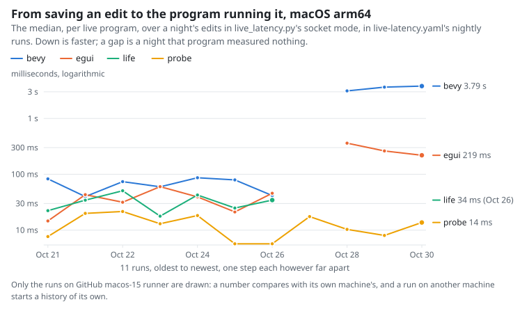
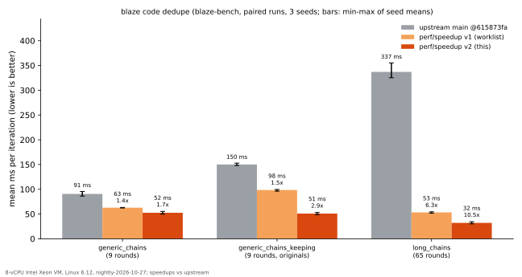

<p align="center">
  <picture>
    <source media="(prefers-color-scheme: dark)" srcset="docs/brand/fire/header-dark.webp">
    
  </picture>
</p>

<h3 align="center">Rebuild Rust in milliseconds.</h3>

<p align="center">Type <code>blaze</code> wherever you'd type <code>cargo</code>.<br>Blazingly fast Rust, literally.</p>

<p align="center">
  <a href="#install">Install</a> ·
  <a href="#try-it">Try it</a> ·
  <a href="#how-fast">How fast</a> ·
  <a href="#how-it-works">How it works</a> ·
  <a href="#learn-more">Docs</a>
</p>

## Install

```sh
curl -fsSL https://ix.dev/blaze | sh
```

For macOS on Apple silicon and Linux, with or without Rust installed: blaze builds with its own
Rust, whatever rustup or the project pins, and the installer downloads it once (about 125 to
160 MB; none when rustup already has that same nightly; v2's blaze cannot fetch it yet:
[toolchain.md](docs/toolchain.md)). Rather use crates.io or Nix?
[Other ways to install](docs/install.md).

That installs **stable**: a release that passed the heavy tests (real projects on macOS and
Linux: cargo, zed, servo, bun, NVIDIA Dynamo, fff, fframes, flox and OpenAI's Codex CLI each
build, build again after an edit faster than with cargo, and pass their tests). **Canary** is the
newest release, out as soon as it is built and promoted to stable unchanged once it passes them ([release.md](docs/release.md)):

```sh
curl -fsSL https://ix.dev/blaze | sh -s -- --channel canary
```

## Try it

In any Rust project:

```text
blaze run     # like cargo run
blaze test    # like cargo test
blaze build   # like cargo build
```

The first build loads your project and compiles every crate of it, with no cargo build and no
rustc. Then change a function and build again: blaze's daemon, still running, builds only what
the edit changed. blaze answers `build`, `check`, `run`, `test` and `bench`; other cargo
commands are not blaze's yet.

## How fast

These numbers are blaze v1's; v2 has not been measured yet.

- Edits rebuild <!-- benchheadline:start -->**10× faster** on macOS arm64, **24× faster** on Linux aarch64 and **11× faster** on Linux x86-64<!-- benchheadline:end --> than with `cargo build`, on average over real projects.
- **About 20 ms** from saving a file to a running program using the new code, with
  [live edits](docs/usage.md#change-a-running-program).

<!-- benchpick:start -->
| Edit one function, then build (Linux x86-64) | `cargo build` | `blaze build` |
|---|---:|---:|
| ripgrep | 508 ms | **56 ms** (9.1× faster) |
| nushell | 1.25 s | **236 ms** (5.3× faster) |
| helix | 2.15 s | **116 ms** (19× faster) |
| bun (1.25M lines of Rust) | 9.11 s | **451 ms** (20× faster) |
<!-- benchpick:end -->

Every project, platform, chart, and the memory and disk it takes: [benchmarks](docs/benchmarks.md).

### Over time

<!-- benchtrend:start -->
How blaze's own numbers move from run to run, each platform on its own benchmark machine: the instructions each merge to main retires, how long an edit takes and how soon a live edit runs, from [the history](docs/benchmarks/history) ([how it is kept](docs/benchmarks.md#history-and-regressions)). Every workflow that adds to the history draws these again and commits them with it.

<picture><source media="(prefers-color-scheme: dark)" srcset="docs/benchmarks/charts/trend-macos-arm64-live-dark.svg"></picture>

Not drawn until there are two runs on one machine: macOS arm64 instructions per merge (none yet), macOS arm64 edit times (one run), Linux aarch64 instructions per merge (none yet), Linux aarch64 edit times (one run), Linux x86-64 instructions per merge (none yet), Linux x86-64 edit times (one run), Windows x86-64 live-edit latency (one run).
<!-- benchtrend:end -->

## Benchmarks (this fork, `perf/speedup`)

This fork speeds up one stage of blaze's codegen, **code dedupe** (identical code folding).
Upstream's own benchmark measures it (`crates/blaze-bench/benches/dedupe.rs`).



| Scenario | upstream `main` @615873fa | this fork | speedup |
|---|---:|---:|---:|
| `dedupe/generic_chains` (32,768 functions, 9 rounds) | 90.6 ms (86.2–95.6) | 52.5 ms (49.8–55.3) | **1.7×** |
| `dedupe/generic_chains_keeping` (the same, with originals kept) | 150.1 ms (148.0–152.8) | 50.9 ms (48.7–53.1) | **2.9×** |
| `dedupe/long_chains` (32,768 functions, 65 rounds) | 337.1 ms (325.2–355.2) | 32.0 ms (30.2–34.4) | **10.5×** |
| `dedupe/floor/clone`, `floor/code_ids` (controls) | 4.4–4.9 / 11.9–12.6 ms | 4.2–4.9 / 11.4–12.2 ms | ~1.0× |

How these were measured:

- **Runs:** blaze-bench's paired `compare`, `-t 20 -o`, seeds 1, 2 and 3. Each cell is the mean
  per iteration, and the range is the spread of the three per-seed means. Every scenario
  difference is significant (|z| ≥ 2.6).
- **Noise:** the control rows set the noise floor at about 5%.
- **Machine:** an 8-vCPU Intel Xeon VM running Linux 6.12, built with `nightly-2026-10-27`.
- **Reproducing:**

  ```sh
  NEW=$(ls -t target/release/build/blaze-bench/*/out/dedupe-* | head -1)   # after: cargo +nightly-2026-10-27 bench -p blaze-bench --bench dedupe --no-run
  "$NEW" compare /path/to/upstream/dedupe-bench-binary -t 20 -o --seed 1
  ```

  The full steps, the raw output and the correctness tests (an equivalence check against
  upstream's implementation on thousands of random builds) are in [PERF.md](PERF.md).

**Not measured: end-to-end rebuild times.** blaze needs Linux 7.3 or later to run, and the
benchmark machine runs 6.12, so the "How fast" numbers above are upstream's and were not
re-measured. Dedupe is one stage of a build, so these speedups are not rebuild speedups.

## How it works

blaze's daemon keeps your project compiled in memory, with no cargo or rustc under it. After an
edit it compiles only the functions you changed and links the program again with its own linker.
[More](docs/v2/plan.md).

## Good to know

- **macOS on Apple silicon and Linux.** Windows has no installer, and v2 has not been run there
  ([v1 on Windows](docs/platforms.md#windows-x86-64-msvc)).
- **blaze is its own toolchain.** It builds every project with its own Rust, `blaze-2026-10-27`
  (today the nightly of that date), whatever the project pins; stable code and
  `#![feature(...)]` code build. Your toolchain and CI stay the final word
  ([why](docs/toolchain.md)).
- **It trades memory for speed:** a few GB for a small project.
- **It's young.** Keep `cargo check` or your CI as the final word, and
  [tell us](https://github.com/indexable-inc/blaze/issues) when something differs from cargo.

All the details: [what works and what doesn't yet](docs/usage.md#what-works-and-what-doesnt-yet).

## Learn more

- [Install](docs/install.md): requirements, crates.io, Nix
- [Using blaze](docs/usage.md): day to day, rebuild on save, making plain `cargo build` use blaze
- [Benchmarks](docs/benchmarks.md): every number, how it's measured, and on what machines
- [How it works](docs/v2/plan.md): the plan of blaze v2, and a map of its crates
- [Cargo compatibility](docs/cargo.md): every command, flag and setting
- [CI runner](docs/v2/plan.md) and [roadmap](docs/v2/plan.md): where blaze is going
- [Contributing](docs/contributing.md)

## Demo: a Game of Life you can edit

```sh
nix run github:indexable-inc/blaze#life
```

This opens a Game of Life window. On macOS on Apple silicon you can change its rules, colours and
speed while it runs (live edits are blaze v1's; v2 does not have them yet); elsewhere the window
runs without live edits. It needs Nix, and builds blaze
from source the first time.


## Updates

[What's new](https://ix.dev/blaze/updates) has every change worth knowing, each as a short lesson on the course,
with the ones new since your last visit marked. For release news: Watch → Custom → Releases on GitHub.

## Using blaze at work?

We're working with a few teams on fast Rust CI and remote builds, built on blaze. If your team
waits on Rust builds, tell us what slows you down: [andrew@ix.dev](mailto:andrew@ix.dev). Teams
we work with get early access and a direct say in what we build next.

## Contributing

How to build blaze from a checkout, run its tests and send a change:
[docs/contributing.md](docs/contributing.md). To report a security problem:
[.github/SECURITY.md](.github/SECURITY.md).

## Credits

blaze stands on the shoulders of giants. Thank you to the people who built:

- [rust-analyzer](https://github.com/rust-lang/rust-analyzer), whose analysis and MIR blaze compiles from
- [Cranelift](https://cranelift.dev) (Bytecode Alliance), the fast code generator
- [LLVM](https://llvm.org) and [inkwell](https://github.com/TheDan64/inkwell), for the optimised tiers
- [salsa](https://github.com/salsa-rs/salsa), the incremental engine underneath
- [object](https://github.com/gimli-rs/object), for reading and writing executables
- [Rust](https://github.com/rust-lang/rust) and its compiler crates
- [rustd](https://github.com/DioxusLabs/rustd) (DioxusLabs), whose code blaze includes
- [Makepad](https://github.com/makepad/makepad), whose live-coding work inspired much of blaze, and
  its JIT [relax](https://github.com/makepad/makepad/tree/work/libs/relax), behind `makepad run`

None of these projects endorses blaze.

blaze was called ra-jit until 2026-10-24; Made at [ix](https://ix.dev)
for den's native app. MIT or Apache-2.0.
